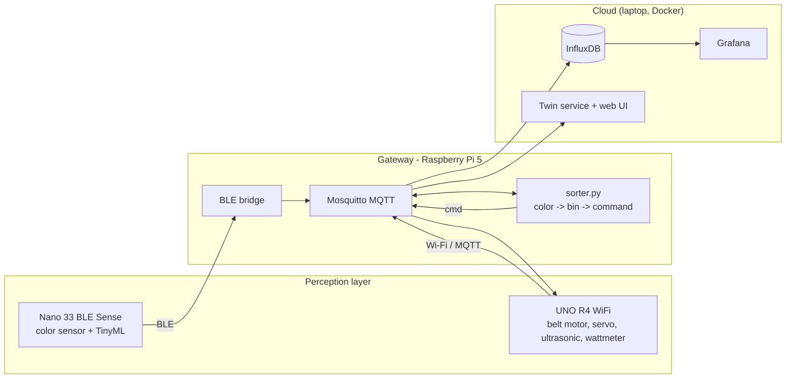

# Architecture

## Flow of one item
1. Ultrasonic sensor (UNO) sees an item: `line/ultrasonic` / `line/item` event.
2. Item reaches the color station; Nano reads RGB, classifies it, sends `{color, confidence}` over BLE.
3. BLE bridge on the Pi republishes it to MQTT as `color/classification`.
4. `sorter.py` maps color to bin and publishes `line/cmd` `{action: "divert", bin, delay_ms}`.
5. UNO moves the servo after `delay_ms`; item falls in the bin; UNO publishes `line/bin` count event.
6. Twin service updates the item and bin state; Grafana shows history.

## Layers (course mapping)
- Perception and communication: Nano, UNO, BLE, Wi-Fi
- Processing: gateway (sort logic), TinyML on the edge, cloud (storage, twin)
- Application: web twin and Grafana dashboards

## To decide this week
- Stop-and-read vs. free-running belt (start with stop-and-read)
- Which color sensor (Nano APDS-9960 first, TCS34725 if readings are noisy)
- Belt motor: 130 DC motor (PWM) vs. stepper
